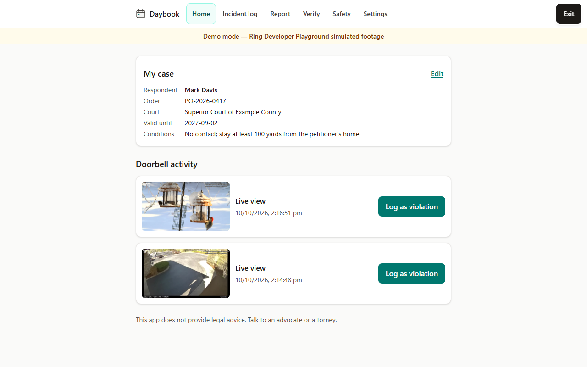
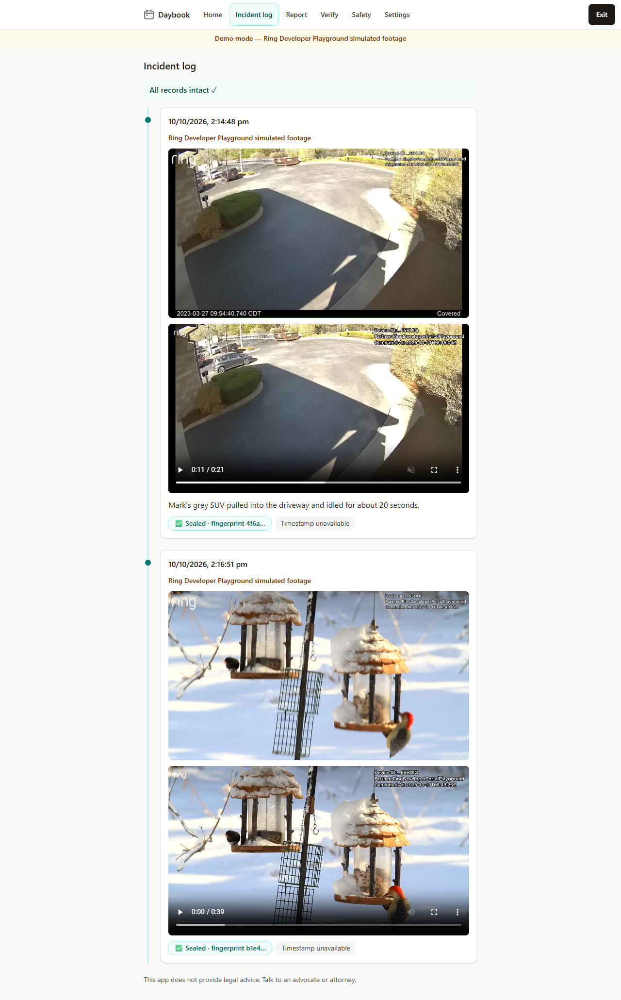
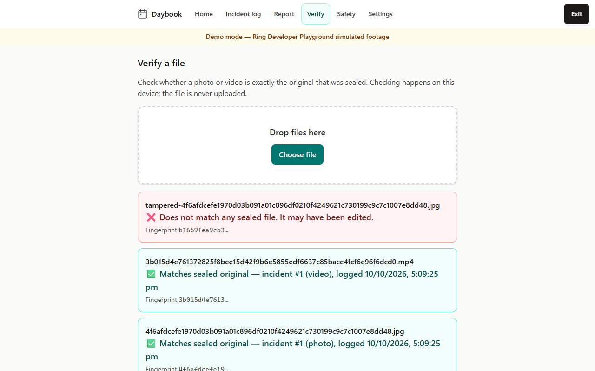
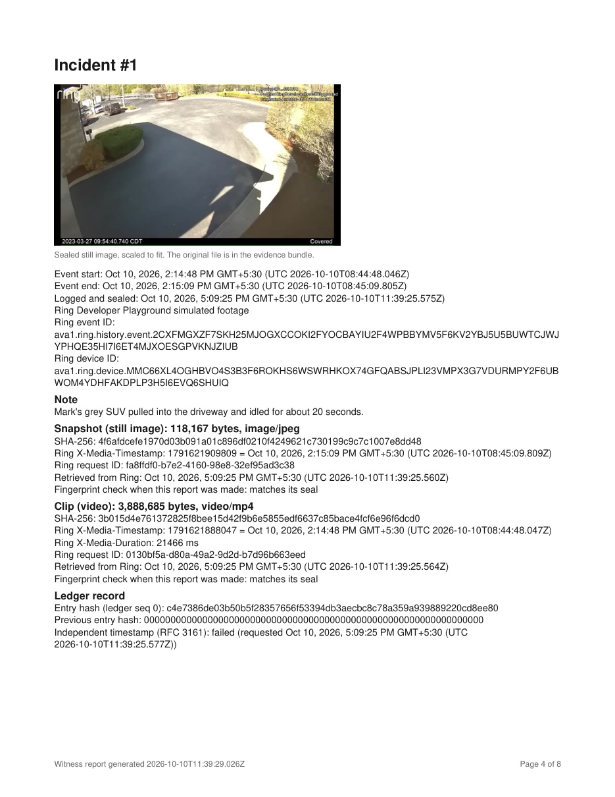
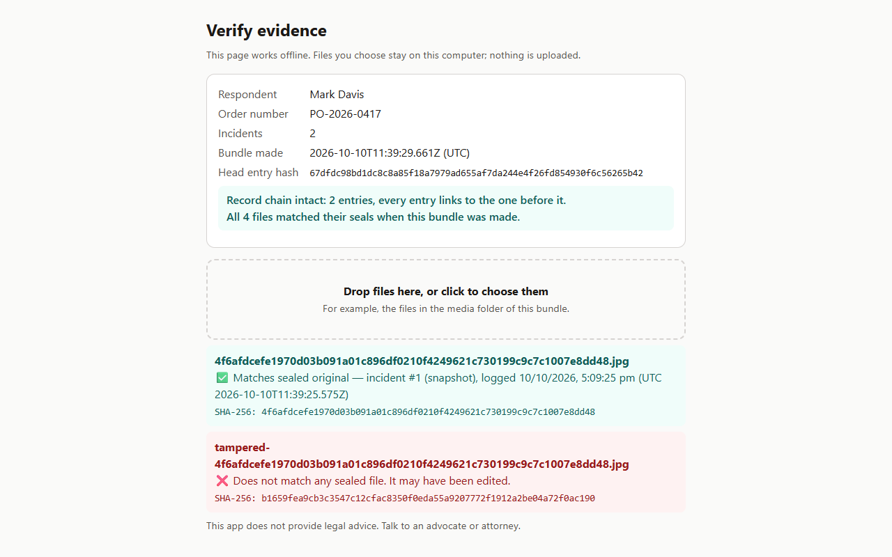
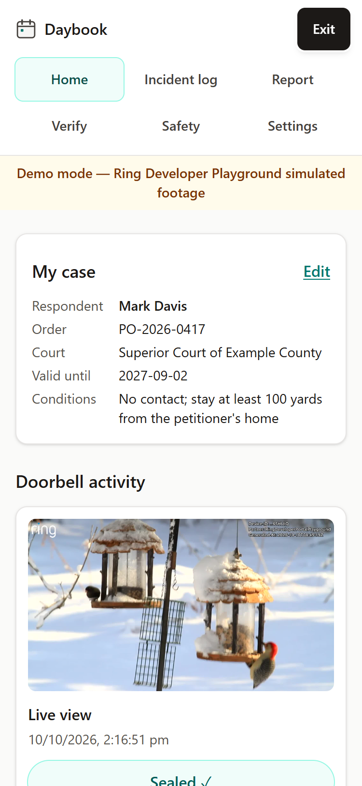
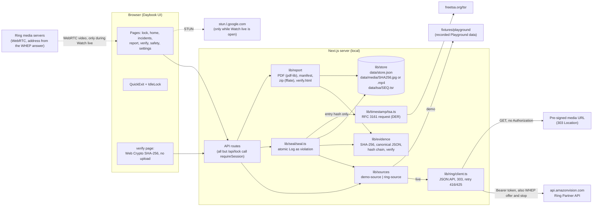

# Witness

**Witness turns Ring doorbell clips into sealed, tamper-evident records of protective-order violations that a survivor can hand to an advocate, the police or a court.**

The survivor taps **Log as violation** on a doorbell event. Witness then:

1. downloads the original photo and video from the Ring API,
2. seals them into a hash-chained ledger, and
3. builds a court-ready PDF plus an evidence bundle that anyone can verify offline.

For the survivor's safety, the app presents itself as **"Daybook"**, a plain journal. It is locked with a PIN and has a one-tap quick exit.

> This app does not provide legal advice. Talk to an advocate or attorney.

Built for the *Build, Ship, Shape* Amazon Developer Hackathon (Ring track and Open Source mini challenge). MIT licensed.

| Doorbell activity | Sealed incident log | Tampered copy fails verification |
|---|---|---|
|  |  |  |

| Court report (PDF) | Offline `verify.html` in the evidence bundle | Phone layout |
|---|---|---|
|  |  |  |

*All names in the screenshots ("Sarah Miller", "Mark Davis", "PO-2026-0417") are fictional. The footage is Ring Developer Playground simulated footage.*

---

## Why

- **Protective orders are broken often.** A review of 43 studies found that about **40–50% of protective orders are violated** ([source](https://www.ingentaconnect.com/contentone/springer/pa/2012/00000003/00000004/art00006)). In the Kentucky Civil Protective Order Study, about **half of women reported a violation within six months** ([source](https://vawnet.org/material/kentucky-civil-protective-order-study-rural-and-urban-multiple-perspective-study)).
- **Reported breaches often go nowhere.** West Midlands Police recorded roughly **1,300–2,000 non-molestation order breaches a year in 2020–2023, and about 3 in 4 ended in "no further action"** ([FOI response](https://foi.west-midlands.police.uk/restraining-orders-351a-24/)).
- **Violations are hard to prove, and footage gets challenged.**
  - Advocates say violations are hard to prove, and that doorbell footage has led to an added charge ([KLKN](https://www.klkntv.com/?p=4580278)).
  - Defendants argue in court that footage was altered ([Court of Appeals of Virginia opinion](https://www.vacourts.gov/opinions/opncavwp/1793221.pdf)).
- **The scale is large.** More than **1 in 3 US women and about 1 in 6 men** experience intimate-partner violence or stalking ([CDC NISVS, summarised by Safe States](https://www.safestates.org/news/722022/CDC-Releases-the-National-Intimate-Partner-and-Sexual-violence-Survey.htm)).
- **Ring already reaches this group.** Through the **Ring × NNEDV donation program**, about **35,000 Ring doorbells and cameras** have gone to survivors through 750+ organisations over four years ([NNEDV](https://nnedv.org/latest_update/ring-and-nnedv-announce-the-fourth-year-of-the-ring-donation-program-for-domestic-violence-survivors)). Nothing helps turn that footage into evidence that holds up.
- **No existing app does this.** None of the 64 apps in the Ring Appstore (as of October 2026) focuses on domestic violence or accessibility. We scanned about 75 other Ring-track hackathon projects, and none handles DV evidence.

## What it does

| Step | Screen | What happens |
|---|---|---|
| Unlock | `/lock` ([01](docs/screenshots/01-lock.png)) | A plain "Daybook" screen asks for a 4–8 digit code. The first run sets the code. |
| Case setup | `/setup` ([02](docs/screenshots/02-setup.png)) | Enter the order details once: names, order number, court, dates and conditions. These go on the report. |
| Doorbell activity | `/` ([03](docs/screenshots/03-activity.png)) | Shows recent Ring events with a thumbnail and a **Log as violation** button. |
| Watch live → Capture this moment | `/` (live mode only) | **Watch live** shows the doorbell's live video (WebRTC/WHEP, video only) with a countdown. **Capture this moment** ends the stream, waits for Ring's recording of it to appear in history, and opens the same Log dialog to seal it. Tested live against the Ring Developer Playground on 2026-10-10 (video arrived in about 5 s; the captured recording opened in the Log dialog). |
| Seal | dialog ([04a](docs/screenshots/04a-log-dialog.png), [04](docs/screenshots/04-seal.png)) | Add an optional note, then tap **Seal**. Witness downloads the snapshot and clip from Ring, stores the bytes untouched, and appends a hash-chained ledger entry. It then requests an RFC 3161 timestamp, which is best effort. |
| Incident log | `/incidents` ([05](docs/screenshots/05-incidents.png)) | A timeline of sealed incidents with the photo, the playable clip, a "Sealed · fingerprint" badge and the timestamp status. It shows "All records intact ✓" only when the chain, every file and every timestamp check out. |
| Report | `/report` ([06](docs/screenshots/06-report.png)) | Two downloads with neutral file names (`daybook-record-YYYY-MM-DD`): **the PDF**, and **the evidence bundle** (`.zip`) holding the PDF, the original media, `manifest.json`, an offline `verify.html`, `README.txt` and the timestamp tokens. |
| Verify | `/verify` ([07](docs/screenshots/07-verify-pass.png), [08](docs/screenshots/08-verify-fail.png)) | Drop any file. It is hashed in the browser, never uploaded, and the page says ✅ matches a sealed original, ⚠️ matches a record whose seal is broken, or ❌ does not match. |
| Safety | `/safety` ([09](docs/screenshots/09-safety.png)) | Device-safety warning, helplines, how quick exit works, and a link to NNEDV's Safety Net (techsafety.org). |
| Settings | `/settings` ([13](docs/screenshots/13-settings.png)) | Paste a Ring token, toggle Demo mode, or change the code. |

**The report PDF** (`lib/report/pdf.ts`) has these pages, in order:

1. Cover
2. Order details
3. Incident timeline
4. One page per incident, with the sealed still, SHA-256 hashes, `X-Media-Timestamp`, `X-Media-Duration`, Ring request IDs, retrieval times and ledger hashes
5. Chain of custody and integrity (it prints **INTEGRITY WARNING** if anything fails)
6. How to verify
7. A declaration template with blanks to sign

## Quick start: Demo mode (no Ring account needed)

Demo mode is on by default. It replays two real responses recorded from the Ring Developer Playground on 2026-10-10: a *Vehicle* event and a *Motion* event, with their JPEG and MP4 bytes and response headers (`app-witness/fixtures/playground/`). Everything it shows is labelled "Ring Developer Playground simulated footage".

You need **Node.js 24 or newer** and Git. Check your version with `node --version`.

**Windows (PowerShell)**

```powershell
winget install OpenJS.NodeJS.LTS   # or download Node 24+ from https://nodejs.org
git clone <this-repo-url> witness
cd witness\app-witness
npm install
npm run dev
```

**macOS**

```bash
brew install node@24   # or download from https://nodejs.org
git clone <this-repo-url> witness
cd witness/app-witness
npm install
npm run dev
```

**Linux**

```bash
nvm install 24         # or use your distribution's Node 24 package
git clone <this-repo-url> witness
cd witness/app-witness
npm install
npm run dev
```

Then:

1. Open **http://localhost:3000**. The server listens on 127.0.0.1 only, so it is reachable from this computer and not from the rest of the network.
2. Set a 4–8 digit code.
3. Fill in the case details. Only the respondent's name is required.
4. On Home, click **Log as violation** on the second event: the parking-lot thumbnail, which is the Vehicle stream. Times are shown in your own time zone.
5. Open **Incident log**, then **Report**, then **Verify**.

To see a failed verification, download the evidence bundle and unzip it. Open a photo from `media/` in any image editor, change one pixel, save a copy, and drop both files on the Verify page.

## Live mode: Ring Developer Playground

1. Open the **[Ring Developer Playground](https://developer.amazon.com/ring/console/playground)**, sign in with a free Amazon Developer account, and click **Generate Token**. The token lasts about 30 minutes.
2. **After** generating the token, scroll down the Playground page to the simulated live-view buttons and click **Vehicle** or **Motion** (or Package). Wait for the session to finish, about 20–40 seconds. This creates a history event.
   - Footage from before the token was issued is refused by Ring with `403 TIME_RANGE_NOT_AUTHORIZED`. See the [friction log](docs/submission/friction-log.md).
3. In Witness, open **Settings**, paste the token and click **Save token**. Saving a token turns Demo mode off.
   - Or put `RING_ACCESS_TOKEN=<token>` in `app-witness/.env.local`, restart `npm run dev`, and switch **Demo mode** off in Settings.
4. Go to **Home**. The new event appears. Click **Log as violation**, then **Seal**.
   - If Ring answers `425 RECORDING_NOT_READY` or `416`, Witness retries after 5, 10, 20 and 30 seconds.
   - If the token has expired, Home shows a calm **Reconnect Ring** banner with a link back to the Playground.

To exercise the same client from the command line:

```bash
cd app-witness
RING_ACCESS_TOKEN=<token> npx tsx scripts/ring-check.ts
```

The script lists devices and events and downloads one snapshot and one clip. It also reads the token from a `.env.local` at the repo root, and never prints it.

## Architecture

A single local **Next.js 15 (App Router) + React 19 + TypeScript** app. Ring is only ever called from the server, which keeps the token out of the browser and avoids CORS.



**Log as violation, step by step** (`lib/seal/seal.ts`):

1. Download the snapshot, then the clip, keeping both in memory. Nothing is written unless the required downloads succeed.
   - If the clip stays unavailable after the retries, the snapshot is sealed alone and the record is marked `clipUnavailable`.
2. Write each file as `data/media/<sha256>.<ext>`. The name is its own fingerprint, and the bytes are never re-encoded.
3. Inside the store lock, append the entry: `{seq, prevHash, incidentId, ringEventId, deviceId, eventStart, eventEnd, media[{sha256, bytes, contentType, ringMediaTimestamp, ringMediaDuration, ringRequestId, retrievedAt}], clipUnavailable, note, loggedAt, source}`.
   - `entryHash` is the SHA-256 of the canonical JSON of that body. The first entry's `prevHash` is 64 zeros.
4. Request an RFC 3161 timestamp for `entryHash` from FreeTSA. This can never block or undo the seal; a failure is recorded as "Timestamp unavailable".

### Where the Ring API is called

All calls go through `app-witness/lib/ring/client.ts`. Base URL: `https://api.amazonvision.com` (`client.ts:6`).

| Ring endpoint | Where | Notes |
|---|---|---|
| `GET /v1/devices?include=status` | [`lib/ring/client.ts:138`](app-witness/lib/ring/client.ts#L138) | Joins online status from `included` `device-status` resources (`client.ts:100-105`). |
| `GET /v1/history/devices/{device_id}/events` | [`lib/ring/client.ts:153`](app-witness/lib/ring/client.ts#L153) | Follows `links.next` (`client.ts:158-166`), refuses any next link to another origin so the token cannot leak, and sorts newest first. |
| `POST /v1/devices/{device_id}/media/image/download` | [`lib/ring/client.ts:269`](app-witness/lib/ring/client.ts#L269) | Body `{"type":"latest_in_range", start_timestamp, end_timestamp, image_options:{format:"jpeg", resolution:1920×1080}}` (`client.ts:270-273`). |
| `POST /v1/devices/{device_id}/media/video/download` | [`lib/ring/client.ts:279`](app-witness/lib/ring/client.ts#L279) | Body `{timestamp, duration}`, with duration clamped to 1,000–900,000 ms (`client.ts:277-278`). |
| 303 → pre-signed media URL | [`lib/ring/client.ts:171-208`](app-witness/lib/ring/client.ts#L171) | `redirect: "manual"` (`:174`). The `Location` URL is fetched **without** the Authorization header (`:192`). `X-Request-ID`, `X-Media-Timestamp`, `X-Media-Duration` and `Content-Type` are captured (`:189`, `:202-205`). |
| `POST /v1/devices/{device_id}/media/streaming/whep/sessions` (live view) | [`lib/ring/client.ts:238-253`](app-witness/lib/ring/client.ts#L238) | Body is the browser's raw SDP offer, `Content-Type: application/sdp` (`:244`): one video transceiver, receive-only, no audio, sent after ICE gathering completes. Expects `201` with the SDP answer (`:248`). The `Location` session URL must be on `https://api.amazonvision.com` or it is refused (`:249-251`, `apiUrl` at `:227-236`). Relayed by `app/api/live/route.ts`, which keeps that URL on the server and gives the browser only a random id. |
| `DELETE` WHEP session (`Location` URL) | [`lib/ring/client.ts:255-261`](app-witness/lib/ring/client.ts#L255) | Ends the session on Stop, on Capture this moment, when the countdown ends, when the page is left, and when the app locks or Quick exit is used (`lib/live/sessions.ts:48-52`). Only an `https://api.amazonvision.com` URL is accepted; `2xx` and `404` count as closed (`:259`). |
| Error handling | [`lib/ring/client.ts:125-129`](app-witness/lib/ring/client.ts#L125), [`:178-186`](app-witness/lib/ring/client.ts#L178), [`:210-221`](app-witness/lib/ring/client.ts#L210) | 401 becomes `RingAuthError`. 416/425 on the POST or the signed GET are retried after 5, 10, 20 and 30 s. `403 TIME_RANGE_NOT_AUTHORIZED` becomes `RingMediaUnavailable`. |

The client is used by:

- `lib/sources/ring-source.ts:10, 28, 31, 34, 38, 41`: uses the first device shared with the token. Only this source has `live` (live view); the demo source does not.
- `lib/sources/source.ts:31`: picks live or demo.
- The API routes:
  - `app/api/events/route.ts:14` (activity list)
  - `app/api/events/[id]/thumb/route.ts:31` (thumbnails)
  - `app/api/incidents/route.ts:70` → `lib/seal/seal.ts:48, 53` (sealing)
  - `app/api/live/route.ts:28, 47` (live view start and stop; demo mode answers `409 live-unavailable`)
- `scripts/ring-check.ts:25-43`.

Ring errors become user-facing states in `lib/api/http.ts:74-85`:

- `401` → `reconnect-ring`
- `RingMediaUnavailable` → `422 footage-unavailable`, which shows the message "Footage not accessible with this token…" (`components/LogDialog.tsx`)

The token is redacted from every error message.

## Trust model: what a report does and does not show

The report's "What these records show" section (`lib/report/pdf.ts:88-94`) says exactly this, and no more:

1. **Ring's watermark** in each image shows the Ring device and **the time the image was downloaded from Ring**. It does *not* show the capture time (see friction log item E). The capture time comes from Ring's `X-Media-Timestamp` header, which is recorded per file.
2. **The SHA-256 fingerprints** show that the files match the fingerprints **recorded when they were sealed**.
3. **The hash chain** shows that no incident was removed, inserted or reordered **within the chain**, unless every later record was re-sealed; the independent timestamps and the head hash in earlier reports detect such a rewrite.
   - Removing the *most recent* entries is detected by comparing the head hash and entry count (printed on the cover) with an earlier report, or with a trusted timestamp.
4. **Where present, an independent RFC 3161 timestamp** (FreeTSA) shows that the record's fingerprint existed at the stated time.
   - Witness checks that each stored token names the record's **current** entry hash (`tsrCoversHash` in `lib/timestamp/tsa.ts`). If it names another hash, the record was changed and re-sealed after it was timestamped: the report prints INTEGRITY WARNING, and the record is treated as having a broken seal everywhere. Witness does not validate the token's signature or nonce itself (see Limitations).
5. **The chain of custody** records when each file was retrieved from Ring, and the Ring request ID.

If any check fails, the report says so:

- The cover says "PROBLEMS FOUND".
- The integrity page prints **INTEGRITY WARNING**, with the reason for each failure.
- A record whose seal is broken, or whose timestamp names a different hash, is never vouched for. The in-app verifier, `verify.html` and the PDF all treat it as "matches a record whose seal is broken", and the PDF withholds its image (`lib/evidence/verify.ts`, `lib/report/pdf.ts:449-472`).
- The Incident log re-checks every record, file and timestamp each time it opens. It shows "All records intact ✓" only when all of them pass. Otherwise it names the incidents with a problem, and each one's badge reads "Seal broken — see report". A media file that no longer matches its fingerprint is not served to the app at all (`app/api/media/[...file]/route.ts`).

Anyone can re-check the files without Witness. Use `verify.html` (offline, inline script, no network), or the command line:

- Windows: `certutil -hashfile <file> SHA256`
- macOS or Linux: `shasum -a 256 <file>`
- Timestamps: `openssl ts -reply -in timestamps/N.tsr -text`

## Safety design

- **Disguise.**
  - The tab title is "Daybook" on every page (`app/layout.tsx`).
  - The lock screen says nothing about abuse, violations or evidence.
  - Downloads are named `daybook-record-YYYY-MM-DD.pdf|zip` (`app/api/report/route.ts:9-12`).
- **Lock.**
  - The code is 4–8 digits, stored only as an scrypt hash (N=16384) with a random 16-byte salt (`lib/auth/pin.ts`).
  - After 5 wrong tries there is a 30-second cooldown, shared by unlock and code change. Attempts are serialised so parallel guesses cannot bypass it (`lib/auth/attempts.ts`).
  - The session cookie is `HttpOnly; SameSite=Strict`.
  - The app locks after 5 minutes idle (`components/IdleLock.tsx`).
- **Quick exit.**
  - A fixed **Exit** button on every page, or **Esc pressed twice within 1 s**, calls `location.replace("https://weather.com")` and ends the session (`components/QuickExit.tsx`, `lib/ui/quick-exit.ts`).
  - In-app links replace history entries (`components/AppLink.tsx`), so Back after an exit does not return to the app.
- **Quiet and local.**
  - No notifications, no accounts, no cloud.
  - Data lives in `app-witness/data/`, which is git-ignored.
  - The server binds to **127.0.0.1** only (`npm run dev` and `npm start` pass `-H 127.0.0.1`), so other devices on the same Wi-Fi cannot reach it.
  - Requests that change data must be JSON from the app's own origin. Cross-site requests get `403` (`rejectCrossSite`, and `rejectForeignOrigin` for the live-view stop, in `lib/api/http.ts`).
  - While the app runs, its only outbound calls go to the Ring API and its signed media URLs (in live mode), and to FreeTSA, which receives **only the entry hash**.
  - Only while **Watch live** is open, the browser also asks Google's public STUN server (`stun.l.google.com:19302`) for its public network address (so Google sees that address), and receives the video from Ring over WebRTC. Nothing about the doorbell or the case goes to the STUN server. The Ring token and Ring's session URL stay on the server.
  - Next.js itself sends anonymous usage telemetry from its CLI (`next dev`, `next build`) unless it is turned off. Set `NEXT_TELEMETRY_DISABLED=1` in your shell or in `app-witness/.env.local` (it is in `.env.example`).
- **The Safety page** warns that the app may not be safe if the abuser can access the device. It lists the US and UK helplines and links to NNEDV Safety Net.
- **No recognition of people.** There is no face, person or plate recognition, and no sharing or contact features. The survivor alone decides what is a violation.

## Testing

```bash
cd app-witness
npm test            # vitest: 217 tests in 22 files, all passing (run 2026-10-10)
npx tsc --noEmit
npm run lint
```

What the tests cover (`app-witness/tests/`):

- **Evidence core.** Hashing, canonical JSON, chain linking, and tamper detection of an edited entry, a deleted entry, reordered entries and a bad genesis.
- **Ring client.** It is tested against mocked responses shaped like the recorded Playground ones. Covered:
  - device and status join, pagination, and refusing a cross-origin `next` link
  - following the 303 without the auth header
  - header parsing
  - duration clamping
  - 416/425 retries, 401, `403 TIME_RANGE_NOT_AUTHORIZED`
  - token never leaked in errors
  - live view (WHEP): the raw SDP offer, `201` + answer, refusing a session URL on another origin, `DELETE` with `404` as already closed
- **Sealing.** Atomic seal, duplicate and race handling, clip-unavailable, and the TSA failing open.
- **Reports.** Section order, INTEGRITY WARNING on tampering, never vouching for broken seals, flagging a timestamp that does not match a re-sealed record, and zip contents.
- **Integrity in the app.** The Incident log data flags a changed media file, a broken seal and a timestamp issued for another hash. The media route refuses a changed file with `409`.
- **Live view.** `/api/live` checks the session and origin, validates the offer, answers `409` in demo mode, never returns Ring's session URL or the token, and stops each session once; locking stops any open session. The browser helpers (ICE wait cap, countdown, connection-state handling and connect timeout, finding Ring's `on_demand` recording) are unit-tested. The WebRTC connection was checked in a browser against a local stand-in peer, then end to end against the live Ring Developer Playground on 2026-10-10 (1280×720 H.264 video, Capture this moment found the new `on_demand` recording).
- **App behaviour.** Session gating of the data API routes, refusal of cross-site requests, PIN throttling, and the double-Esc detector.

## Limitations

- **Demo uses Playground data only.**
  - All footage is Ring Developer Playground simulated footage: a parking lot ("Vehicle") and birds at a feeder ("Motion"). It is not a real incident.
  - Every Playground event is `on_demand`, so cards read "Live view".
  - Live mode uses the first device shared with the token.
- **No webhooks.**
  - The Playground sends none, so Witness pulls history when Home opens; nothing is pushed.
- **Live view was tested only against the Ring Developer Playground**, not a physical doorbell. The countdown assumes the 60-second limit of line-powered devices.
  - It is video only (no audio), uses the first device, and needs live mode.
  - Ring ends a session after 30 s on battery devices and 60 s on wired ones. The countdown always starts at 60, so on a battery device the view ends early with "Live view ended".
  - The live view itself is not sealed. Ring's own recording of it (an `on_demand` event) is what gets sealed, through the usual Log dialog, once it appears in history.
- **Local only.**
  - The Ring token is kept in `data/store.json` on this computer.
  - Media is not encrypted at rest yet.
  - Sessions live in server memory (restarting the server locks the app). The idle lock runs in the browser.
- **The timestamp is best effort.**
  - FreeTSA is a free public service. If it can't be reached, the incident is still sealed and marked "Timestamp unavailable".
  - Witness stores the TSA's response and checks that it names the record's current entry hash, but does not itself validate its signature or nonce; use `openssl ts -verify` for that.
  - `WITNESS_TSA=off` disables it.
- **Tail truncation.** Removing the newest entries is only detectable against an earlier report's head hash, or against timestamps.
- **Not legal advice.** Admissibility rules differ by court. The declaration in the report is a template only.

This app does not provide legal advice. Talk to an advocate or attorney.

## Environment variables

Put these in `app-witness/.env.local`, or set them in the shell. A template is in `app-witness/.env.example`.

| Variable | Default | Purpose |
|---|---|---|
| `RING_ACCESS_TOKEN` | unset | Ring token used when none is saved in Settings. Demo mode must be off for it to be used. |
| `WITNESS_DATA_DIR` | `app-witness/data` | Where `store.json`, `media/` and `tsa/` live. |
| `WITNESS_TSA` | on | Set to `off` to skip the FreeTSA request (offline demos, tests). |
| `NEXT_TELEMETRY_DISABLED` | unset | Set to `1` to turn off Next.js's anonymous usage telemetry. |
| `NEXT_PUBLIC_IDLE_MS` | `300000` (5 min) | Idle time before auto-lock. Shorter is handy for testing. |
| `WITNESS_FIXTURES_DIR` | `app-witness/fixtures/playground` | Advanced: another folder of recorded demo data. |

## Repository layout

```
app-witness/
  app/            Next.js pages ((app)/ is gated by the session) and API routes (app/api/*)
  components/     QuickExit, IdleLock, EventCard, LogDialog, LiveView, SealedBadge, RingStatus, ...
  lib/ring/       Ring Partner API client
  lib/sources/    live Ring source and demo (fixture) source
  lib/live/       open live-view sessions (server-side only)
  lib/seal/       atomic "Log as violation"
  lib/evidence/   SHA-256, canonical JSON, hash-chained ledger, verification
  lib/timestamp/  RFC 3161 request and response parsing (FreeTSA)
  lib/report/     PDF, manifest, evidence bundle, offline verify.html
  lib/store/      atomic JSON store and content-addressed media
  lib/auth/       PIN hashing, attempt throttle, sessions
  fixtures/playground/  recorded Ring Developer Playground responses (demo mode)
  scripts/ring-check.ts live smoke test against the Playground
  tests/          vitest suites
docs/
  screenshots/    screenshots used in this README and the video
  submission/     Devpost description, product feedback, friction log, video script
```

## Built with

- Ring Partner API (Amazon Vision), through the Ring Developer Playground
- Next.js 15, React 19, TypeScript, Tailwind CSS 4
- pdf-lib and fflate
- Web Crypto (SHA-256), RFC 3161 timestamps from FreeTSA
- Vitest

Built with AI coding assistance (Claude Code); see the [Devpost description](docs/submission/devpost-description.md).

## License

[MIT](LICENSE) © 2026 Revant Raj
